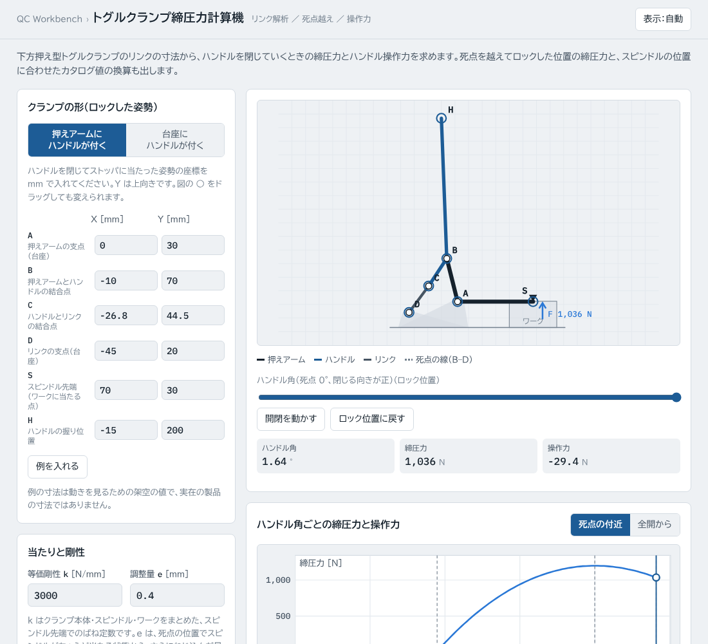
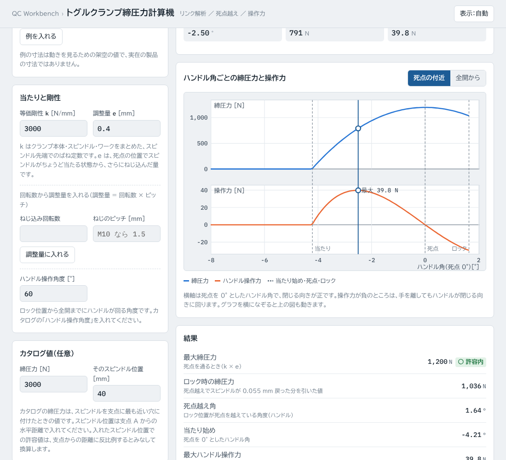
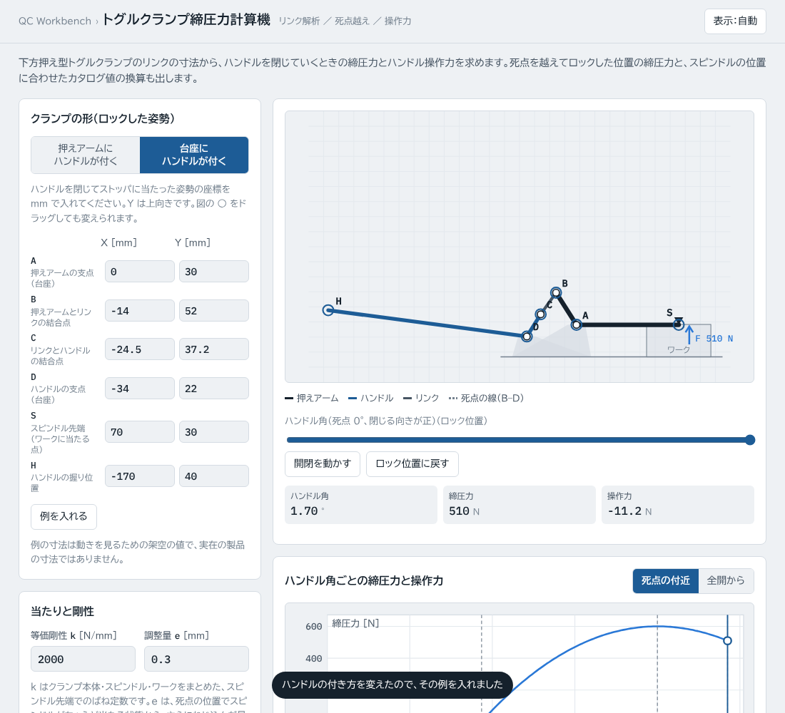

# トグルクランプ締圧力計算機（clamp-calc）

下方押え型トグルクランプのリンクの寸法から、ハンドルを閉じていくときの締圧力とハンドル操作力を求める Web ツールです。死点を越えてロックした位置の締圧力と、スピンドルの位置に合わせたカタログ値の換算も出します。

**https://kotaooka.github.io/clamp-calc/**

インストールは不要で、ブラウザで開くだけで使えます。

- **データは外に出ません**。計算はすべてブラウザの中で行い、どこにも送信しません
- 画面の字体（BIZ UDPゴシック・IBM Plex Mono）は Google Fonts から読み込むため、開いたときに Google のサーバーへ接続します。入力した値は送りません
- 入力した値はこの端末のブラウザに自動で保存し、次に開いたときに続きから使えます
- 一度開けば**オフラインでも動きます**。スマートフォンや PC にアプリとして追加することもできます

---

## なぜ剛体の式では足りないか

トグル機構を剛体として扱うと、締圧力はハンドル操作力 × 倍力比で、倍力比は死点で無限大になります。実際の締圧力は無限大にはならず、死点を越えてストッパに当たった後は、ハンドルから手を離していても締圧力が残ります。この締圧力を決めているのは、スピンドルをどれだけねじ込んだか（調整量）と、クランプ本体・スピンドル・ワークのたわみやすさ（剛性）です。

このツールは、リンクの動きは剛体として正確に解き、当たったところから先は「食い込み量 × 等価剛性」で締圧力を出します。

## 入れるもの

### クランプの形（ロックした姿勢）

ハンドルを閉じてストッパに当たった姿勢で、6 つの点の座標を mm で入れます（Y は上向き）。図の ○ をドラッグしても変えられます。

| 点 | 意味 |
|---|---|
| A | 押えアームの支点（台座） |
| B | 押えアームとカップラ（ハンドルまたはリンク）の結合点 |
| C | カップラとロッカの結合点 |
| D | ロッカ（リンクまたはハンドル）の台座側の支点 |
| S | スピンドル先端（ワークに当たる点） |
| H | ハンドルの握り位置 |

ハンドルの付き方は 2 通りから選びます。

- **押えアームにハンドルが付く**：ハンドルが B で押えアームに付き、リンクが C と台座の D をつなぐ
- **台座にハンドルが付く**：ハンドルが台座の D に付き、リンクが C と押えアームの B をつなぐ

どちらも死点は B・C・D が一直線に並ぶ姿勢で、このとき押えアームが最も下がります。入れた姿勢は「死点を越えた側」として扱い、開くときは死点を通って戻るとみなします。

### 当たりと剛性

- **等価剛性 k [N/mm]**：クランプ本体・スピンドル・ワークをまとめた、スピンドル先端でのばね定数。ロードセルで締圧力を測りながら調整量を変え、締圧力の増え分 ÷ 調整量の増え分で求められます。わからないときは仮の値で傾向を見てください
- **調整量 e [mm]**：死点の位置でスピンドルがちょうど当たる状態から、さらにねじ込んだ量。ねじ込み回転数とピッチからも入れられます
- **ハンドル操作角度 [°]**：ロック位置から全開までにハンドルが回る角度（カタログ値）

### カタログ値（任意）

カタログの締圧力と、その値が出るスピンドル位置（支点 A からの水平距離）を入れると、入れたスピンドル位置での許容値を出して判定します。カタログの締圧力は、スピンドルを支点に最も近い穴に付けたときの値で、先端側に付けるほど小さくなります。

## 出すもの

- **ハンドル角ごとの締圧力とハンドル操作力のグラフ**：横軸は死点を 0° としたハンドル角（閉じる向きが正）。当たり始め・死点・ロックの位置に線を引きます。グラフを横になぞると、その角度の姿勢が上の図に出ます
- **最大締圧力**（死点を通るとき。k × e）と、許容値との判定（○ 許容内 / ✕ 超過）
- **ロック時の締圧力**（死点越えでスピンドルが戻った分を引いた値）
- **死点越え角**、**当たり始めの角度**
- **最大ハンドル操作力**とそのときの角度（握りにハンドルと直角に掛ける力）。死点を越えると負になり、手を離してもハンドルが閉じる向きに回ります
- **死点でのリンク力**（圧縮・引張）と**支点 A の反力**
- **押えアームの開き角**と全開時のスピンドルの持ち上がり

結果は「結果をコピー（Excel 用）」で、入れた値と一緒に Excel に貼り付けられる形でコピーできます。

---

## 計算のしかた

1. 台座・押えアーム・カップラ・ロッカの 4 節リンクを剛体として、ロッカの角度を 0.02° 刻みで動かし、ロック位置から死点を越えて全開まで各部の位置を解きます（2 つの円の交点。組み立て方は直前の姿勢に近いほうを選びます）
2. スピンドル先端 S が最も低くなる姿勢を死点とし、当たり面の高さを「死点で食い込み量 δ = e」になる高さに置きます
3. 各姿勢の締圧力は F = k·δ（当たっていなければ 0）
4. ハンドル操作力は仮想仕事の原理で求めます：F·dδ = Fh ×（握りの移動量のうちハンドルに直角な成分）
5. リンク力と支点 A の反力は、ハンドル操作力が 0 になる死点で、押えアームの A まわりのモーメントのつり合いから求めます
6. カタログ値の換算は、締圧力が支点からの距離に反比例するとみなします（許容値 = カタログ締圧力 × カタログのスピンドル位置 ÷ 入れたスピンドル位置）

入れていないもの：摩擦、自重、戻しばね、部材ごとのたわみの違い（すべて k にまとめています）、ワークの傾き（締圧力は鉛直とみなします）。

## 使うときの注意

- 締圧力は k と e の積で決まるので、k の値の確からしさがそのまま結果の確からしさになります。管理に使うときは実測した k を入れてください
- 死点越え角が 0 に近いと、ワークからの反力でハンドルが開くおそれがあります。画面に注意を出します
- 死点越え角が大きいと、ロック位置でスピンドルが戻って締圧力が下がります。ロック時の締圧力が 0 になるときは画面に出します
- 例の寸法は動きを見るための架空の値で、実在の製品の寸法ではありません

---

## 計算の検証

計算は外部ライブラリを使わずに実装し、検算テストを付けています（push のたびに GitHub Actions で実行）。

- どの姿勢でも各部材の長さが変わらないこと
- 死点で B・C・D が一直線に並び、スピンドルが最も低いこと
- ハンドル操作力を、仮想仕事とは別に、ハンドル・リンク・押えアームの力とモーメントのつり合いから解き直して一致すること（2 通りの付き方で各 5 点）
- 死点の手前で操作力が正、越えると負になり、死点でほぼ 0 になること
- 最大締圧力 = k·e、ロック時の締圧力 = k·（e − スピンドルの戻り）、剛性に比例すること
- 死点リンク力のモーメントのつり合い、カタログ値の換算
- ロック位置がちょうど死点のとき、死点を通らない形、入力の誤りの検出

開発者向けの情報は [DEVELOPMENT.md](DEVELOPMENT.md) にあります。

## ライセンス

[MIT License](LICENSE)
